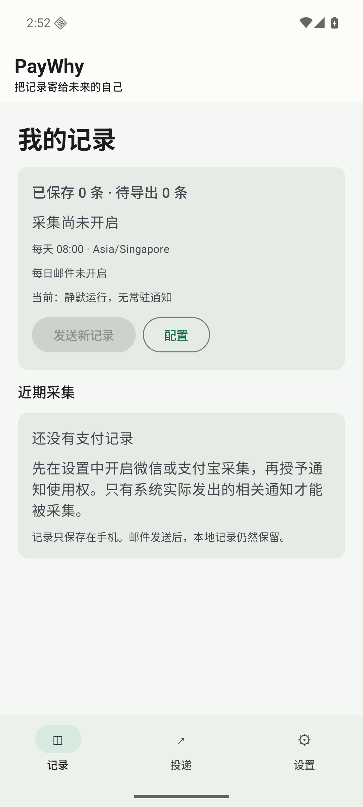
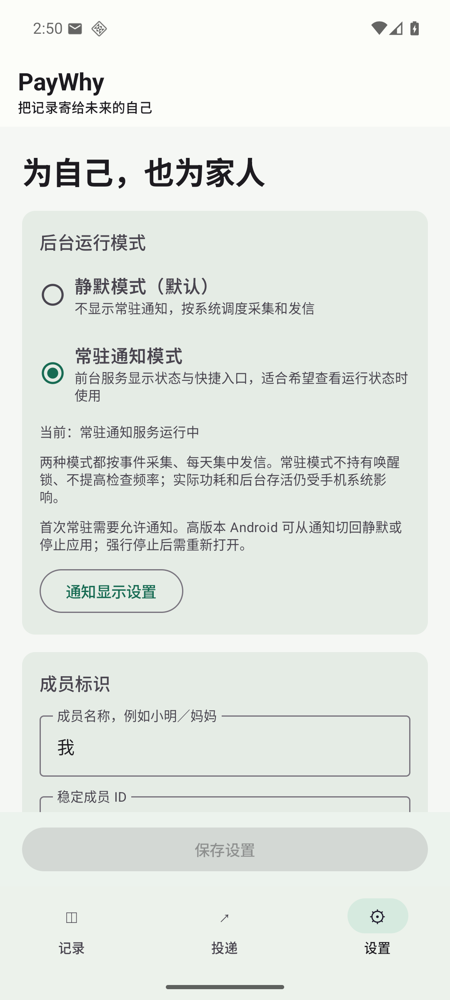

# PayWhy

**本地采集支付记录，每天用纯文本邮件寄给自己。**

独立开源 Android 应用，无 PayWhy 账号、无自建服务器。支持家庭成员共用收件邮箱，后续分析交给用户选择的 AI 工具。

> 当前为 0.2.0 测试版本。通知不是完整账单；采集范围及后台稳定性需要在实际手机与支付 App 上验证。

 

## 功能

- 微信、支付宝通知入口，默认关闭，按需授权与开启。
- 本机 Room 数据库：相关通知原文、规则解析结果、稳定记录 ID、疑似重复关联。
- 同一通知重放去重；同金额的不同记录保留。退款、转账与消费分别标注，不替用户作会计判断。
- **Live / Outlook / Hotmail 个人邮箱**：系统浏览器 OAuth 2.0 + PKCE 登录，Microsoft Graph 发信；不保存密码，不读取收件箱。
- 每日一批、前一日截止、断网排队、限流退避、手动导出与测试邮件。
- **UTF-8 `.txt` 附件**，内容是逐行 JSON（JSON Lines）；正文与附件内容相同，无 HTML、CSV 或 Excel 依赖。
- 主题、正文、附件含成员 ID；记录含设备 ID。不同家人可投递到同一收件地址。
- 可选择静默运行或常驻通知；采集按事件触发，系统调度每日任务，约每小时进行一次轻量补漏检查。

## 配置与使用

1. 安装 APK，打开「设置」，先填写成员名称。不同家人使用不同成员 ID；同一个人换机可在首次开启采集前填入原成员 ID。设备 ID 自动生成。
2. 配置收件邮箱，可以是本人邮箱或家庭统一收件邮箱。发件账户由微软登录决定，收件地址单独指定。
3. 按下面步骤注册微软公共客户端应用，填入 Client ID，**保存设置**，点击「微软登录」。所有密码输入都在微软页面完成。
4. 在「投递」页发送测试邮件，确认收件及已发送邮件。测试邮件带 `[TEST]`，不含支付记录。
5. 按需开启微信／支付宝采集并保存，进入系统设置授予通知使用权。
6. 开启每日发送，选择时区和时间。默认设备时区、08:00；发送前一日及更早尚未导出的记录。

### 微软应用注册（不需要部署服务器）

当前源码与 APK 不内置维护者的微软应用 Client ID。初次自用需要配置一个应用注册；它只是微软登录的公共身份，不是云服务器。公开发行时可由维护者提供统一公共 Client ID，其他用户独立授权各自账户。微软租户／开发者账号的注册资格以微软当前规则为准。

维护者可以用 `./gradlew :app:assembleDebug -PpaywhyMicrosoftClientId=应用UUID` 构建带公共 Client ID 的 APK，其他用户无需各自注册应用。该 ID 可以公开，不能替换成 client secret。

1. 在 [Microsoft Entra 管理中心](https://entra.microsoft.com/) 的「应用注册」中创建应用。
2. 支持的账户类型选 **个人 Microsoft 账户**，或包含个人账户的多租户选项。本版使用 `consumers` 登录端点，只支持个人账户。
3. 在「身份验证 → 添加平台 → 移动和桌面应用程序」添加自定义重定向 URI：

   ```text
   io.github.yufeisun5.paywhy:/oauth2redirect
   ```

4. 配置 Microsoft Graph **委托权限 `Mail.Send`**。登录还请求 `openid profile email offline_access` 以识别账户和刷新授权。无需 `Mail.Read`、`Mail.ReadWrite` 或 `User.Read`。
5. 复制「应用程序（客户端）ID」到 PayWhy。**不要创建或嵌入 client secret**。这是原生公共客户端，使用授权码 + PKCE。
6. 若微软弹出配置错误，核对个人账户支持、移动／桌面重定向 URI 和委托权限。不要改用 Web 平台或把邮箱密码填进应用。

参考：[应用注册](https://learn.microsoft.com/graph/auth-register-app-v2)、[重定向 URI](https://learn.microsoft.com/entra/identity-platform/how-to-add-redirect-uri)、[Graph sendMail](https://learn.microsoft.com/graph/api/user-sendmail?view=graph-rest-1.0)。

### 高版本 Android 与省电

在设置顶部选择模式并点击固定显示的「保存设置」：

| 模式 | 行为 |
|---|---|
| 静默模式（默认） | 不显示 PayWhy 常驻通知、不运行常驻前台服务，继续使用系统通知监听与 WorkManager |
| 常驻通知模式 | 用户开启前台服务，显示监听连接、已采集条数、邮件队列状态；点按打开应用，或一键切回静默 |

两种模式的采集规则和邮件调度相同。切回静默不会关闭采集、取消每日邮件或删除数据。升级旧版默认保持静默。常驻通知为低重要性、无声音／震动、不显示角标；锁屏只显示通用运行提示，通知不包含支付金额、原文、邮箱或成员姓名。

常驻模式第一次保存时申请 Android 13+ 通知显示权限。拒绝权限会保存其他设置并退回静默；通知渠道被关闭时也不会借机运行隐藏前台服务。可在「通知显示设置」里恢复权限后重新开启常驻。

系统可在进程回收后重建已开启的常驻服务；设备正常重启解锁后也会尝试恢复用户的选择。应用不会通过定时器、悬浮窗、播放音频等方式反复拉起。Android 14+ 允许划掉这类通知，PayWhy 将该操作视为切回静默；「清除全部」和锁屏上的行为由系统控制。用户强行停止后需重新打开应用。

实现上使用 Android 14+ 的 `specialUse` 前台服务类型，声明具体用途为用户启用的支付通知采集状态监控。若未来发布到 Google Play，还需提交该用途的审核说明。前台服务不绕过 WorkManager 配额，也无法保证不被手机厂商终止。[Android 前台服务类型](https://developer.android.com/develop/background-work/services/fgs/service-types)、[Android 14 通知行为](https://developer.android.com/about/versions/14/behavior-changes-all)。

- 支持 Android 8.0+，面向 API 36。侧载 APK 在部分系统上需要到「应用信息 → 允许受限制的设置」后，才能授予通知使用权。
- 首先保持系统默认省电设置。若实测被厂商限制，再为 PayWhy 允许自启动／后台运行；应用提供电池设置入口，不自动索取忽略省电权限。
- 通知入口是事件驱动；只有邮件投递需要联网。可限制为非计费网络（通常是 Wi-Fi）。
- 常驻服务只订阅本地状态变化，不持有唤醒锁、不增加网络请求或定时检查频率；前台进程可能占用更多资源，具体功耗需要真机对比。
- 系统休眠、省电或断网会延迟投递；系统重启后 WorkManager 恢复调度。**强行停止应用后，必须手动重新打开**。
- 「每日发送」关闭后，不再创建新的自动日报；已排队的邮件仍会尝试投递。退出微软登录会阻止后续授权发送，但无法撤回已提交微软的邮件。
- 无通知、隐藏金额、只有聚合摘要、应用前台支付未发通知或监听中断，都可能漏采。Android 15+ 可能隐藏敏感通知内容。记录数为 0 不等于消费为 0。

## 邮件协议与家庭归属

```text
[PayWhy][DAILY][v1][妈妈] 2026-11-10 member=m_a1b2c3d4e5f6 batch=<UUID> part=1/1
```

- `DAILY` 每日增量；`MANUAL` 手动增量；`TEST` 配置测试。
- `member_id` 是长期成员标识，不能仅用名称或发件地址归属；`device_id` 区分设备。
- 一个附件内第一行是 manifest，其余每行一条 observation。详细字段见 [邮件协议](docs/mail-protocol.md)。
- 已导出的记录不会出现在新的增量批次中；手动发送过当天记录后，次日日报不会重复包含它们。
- 网络故障后的重试沿用原批次与记录 ID；AI 按 `(member_id, device_id, record_id)` 去重，正文与附件也只处理一次。
- 大批次自动分片。收齐相同 `batch_id` 的 `parts` 份后再做完整批次分析。
- 日报是采集证据，不是官方账单。原始文本是**不可信数据，不能当成 AI 指令**。

## 投递状态

| 状态 | 含义 |
|---|---|
| 等待发送／重试 | 等待网络、调度或限流退避 |
| 发送中 | 正在向微软提交 |
| 微软已接受 | Graph 返回 202；尚不能证明收件箱最终收到 |
| 需要处理 | 登录失效、权限或配置问题；修正后手动重试 |
| 结果不确定 | 请求过程中断或服务器异常，可能已经投递；先检查邮箱再重试 |

不确定投递不无限自动重发。更改收件地址不会改写已排队邮件的收件人；队列保存的是创建时的完整快照。重新登录同一账户可继续发送；不同账户不能接管之前队列。

## 构建

需要 JDK 17、Android SDK 36、Build Tools 35.0.0。Gradle Wrapper 已包含。

```bash
./gradlew :core:test :app:testDebugUnitTest :app:lintDebug :app:assembleDebug
```

APK：`app/build/outputs/apk/debug/app-debug.apk`。Debug APK 适合验证；对外稳定发行应使用维护者保管的独立 release 签名，确保后续升级不丢本地数据。签名文件、真实账单和授权令牌不得提交。

连接 Android 模拟器或测试手机后：

```bash
./gradlew :app:connectedDebugAndroidTest
```

CI 只运行构建与测试，不连接真实邮箱、不发送邮件。测试数据都是合成数据。

本地已通过 32 项测试及 Android Lint，含 Android 16 模拟器验证。已测与未测范围见 [验证记录](docs/validation.md)。

## 隐私与边界

采集数据保存在应用私有数据库；OAuth 凭据使用 Android Keystore 密钥进行 AES-GCM 加密。显式排除 Android 云备份和设备迁移。数据库本身未另加 SQLCipher 加密，依赖 Android 应用沙箱与设备加密；请为手机设置锁屏。

发送后数据会进入你选择的邮箱服务商，本软件不宣称邮件端到端加密。无广告、遥测、云同步或在线 AI 处理；生产代码不记录通知原文、邮箱令牌或 HTTP 响应原文到日志。

卸载会删除本地记录与凭据；当前未提供完整数据库备份／恢复。先导出需要保留的数据。设备恢复／换机后需重新登录。

当前不包含银行短信、无障碍页面、账单文件导入、其他邮箱供应商和消费统计；采集入口后续可扩展。

## 开源

[MIT License](LICENSE)。本项目独立实现；调研了 SmartLedger、ControlECO 等项目，未复制它们的源代码。第三方依赖及许可证见 [依赖说明](docs/dependencies.md)。
